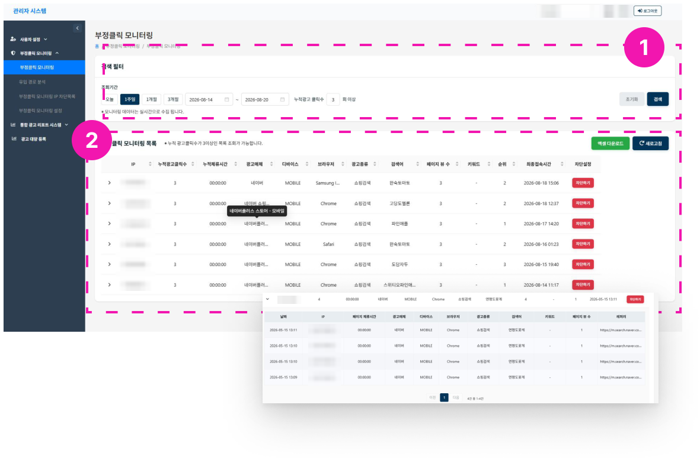
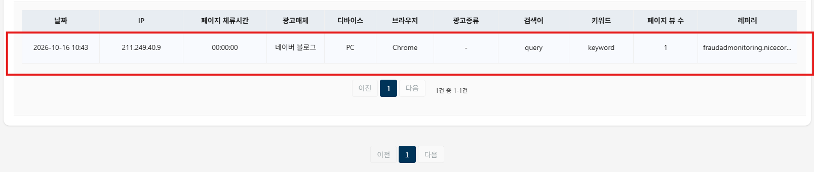

# 모니터링

1. 검색 필터로 최대 3개월의 모니터링 목록을 조회할 수 있습니다.
    - 기본 조회기간: 오늘, 누적광고 클릭수 3회 이상
    - 클릭수 필터 : 클릭수는 default 로 3회 이상으로 설정되어 있습니다. 조회를 원하는 클릭수로 변경 후 조회가능합니다.

    - 초기 설정시 : 쇼핑 검색 추적경유 url 설정 경우, 네이버에서 자동으로 시범 트래픽이 발생합니다. 해당 트래픽은 자동 발생 트래픽이므로 부정클릭에 해당하지 않습니다. 
2. 목록
    1. 스크립트 작동 이후 실시간으로 트래픽을 감지할 수 있습니다.
    2. 동일 IP의 누적광고 클릭수가 3회 이상인 기록을 조회할 수 있습니다.
    3. 동일 IP의 누적광고 클릭수가 3회 이상인 경우, 상세 목록으로 확인할 수 있습니다.
    4. **차단하기** 버튼으로 부정클릭 IP를 차단할 수 있습니다. (현재 네이버 광고만 가능)
    5. 엑셀 다운로드 기능이 있습니다. 다운로드는 화면에 보이는 내용 기준으로 됩니다.
